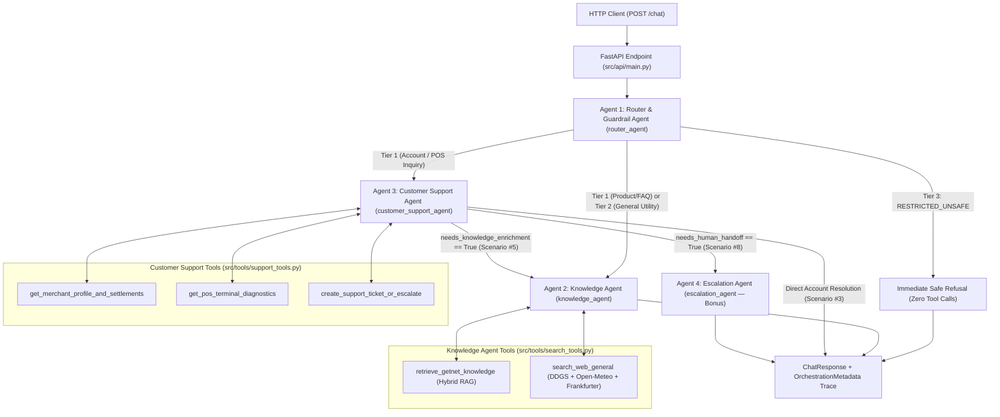

# Getnet Multi-Agent Support & Knowledge Orchestration System

A production-ready, containerized **Multi-Agent Customer Support and Knowledge Orchestration Service** engineered for **Getnet Merchants** using **Spec-Driven Development (SDD)**, **Python 3.12**, **FastAPI**, **LangGraph**, **Pydantic v2**, **SQLite**, and a **Local CPU Hybrid RAG Pipeline**.

---

## 1. Overview & Spec-Driven Development (SDD) Architecture

This repository was designed and implemented following **Spec-Driven Development (SDD)** and **Test-Driven Development (Red → Green → Refactor)**:

1. **Ubiquitous Domain Language ([`GLOSSARY.md`](./GLOSSARY.md))**: Defines strict canonical domain terms (*Merchant*, *POS Terminal*, *Inquiry*, *Settlement*, *Receivables Advance*, *Crediário*, *Payment Link*, *Safety Policy*, *Transaction Decline*, *Support Ticket*, *Human Handoff*) shared across prompts, schemas, database tables, and tests.
2. **Formal System Specification ([`SPEC.md`](./SPEC.md))**: Establishes Pydantic v2 HTTP contracts, the shared `OrchestrationState` schema, deterministic seed data for `cliente1988`, and the **12-Scenario Acceptance Criteria Matrix** before writing application code.
3. **Architecture Decision Records ([`docs/adr/`](./docs/adr/))**:
   - [`ADR-0001`](./docs/adr/0001-langgraph-state-machine-orchestration.md): Explicit LangGraph `StateGraph` orchestration over opaque single-agent loops.
   - [`ADR-0002`](./docs/adr/0002-three-tier-guardrail-policy.md): Three-tier `Safety Policy` (`GETNET_DOMAIN`, `GENERAL_UTILITY`, `RESTRICTED_UNSAFE`) with strict tenant isolation.
   - [`ADR-0003`](./docs/adr/0003-hybrid-rag-ingestion-with-curated-fallback.md): Hybrid RAG combining live `https://www.getnet.net/en` scraping with a version-controlled Getnet Brazil Markdown corpus (`data/getnet_knowledge_base.md`).
   - [`ADR-0004`](./docs/adr/0004-zero-cost-multi-provider-llm-and-local-embeddings.md): Zero-cost multi-provider LLM factory (`heuristic`, `groq`, `gemini`, `ollama`, `openai`), local CPU feature-hashing embeddings (`LocalCPUEmbedder`), and resilient zero-key web search (`ddgs` + Open-Meteo + Frankfurter ECB FX).
   - [`ADR-0005`](./docs/adr/0005-cooperative-agent-chaining.md): Cooperative multi-agent chaining (`customer_support_agent` → `knowledge_agent` and `customer_support_agent` → `escalation_agent`).

---

## 2. Quickstart: Build, Configure & Run

### 2.1 Run with Docker Compose (Recommended)

The service builds and starts with zero mandatory API keys out of the box:

```bash
# 1. Optional: copy .env.example to .env to customize LLM_PROVIDER or API keys
cp .env.example .env

# 2. Build and launch the container on port 8000
docker compose up --build -d

# 3. Verify container readiness via the healthcheck endpoint
curl http://localhost:8000/health
```

Or using standalone `docker` commands:

```bash
docker build -t getnet-multi-agent-support .
docker run --rm -p 8000:8000 --env-file .env.example getnet-multi-agent-support
```

### 2.2 Run Locally with Python Virtualenv (`.venv`)

```bash
# 1. Create and activate a Python 3.11+ / 3.12 virtual environment
python -m venv .venv
# Windows PowerShell:
.\.venv\Scripts\Activate.ps1
# Linux / macOS:
source .venv/bin/activate

# 2. Install package and test dependencies
pip install -e ".[dev]"

# 3. Start the FastAPI server
uvicorn src.api.main:app --host 0.0.0.0 --port 8000 --reload
```

### 2.3 Zero-Cost Multi-Provider Configuration (`LLM_PROVIDER`)

Per [`ADR-0004`](./docs/adr/0004-zero-cost-multi-provider-llm-and-local-embeddings.md), the system supports five `LLM_PROVIDER` modes configured via environment variables or `.env` (see [`.env.example`](./.env.example)):

| `LLM_PROVIDER` | Required Env Vars | Description |
|---|---|---|
| `heuristic` *(default)* | None (`$0` cost) | Deterministic grounded synthesis from RAG chunks and SQLite tool outputs. Works 100% offline with sub-50ms latency. |
| `groq` | `GROQ_API_KEY`, `GROQ_MODEL` | Uses Groq Cloud free tier (default `llama-3.3-70b-versatile`) with automatic fallback on timeout/rate-limit. |
| `gemini` | `GEMINI_API_KEY`, `GEMINI_MODEL` | Uses Google AI Studio free tier (default `gemini-2.5-flash`). |
| `ollama` | `OLLAMA_BASE_URL`, `OLLAMA_MODEL` | Connects to a local Ollama server (default `llama3.2` on `http://localhost:11434`). |
| `openai` | `OPENAI_API_KEY`, `OPENAI_MODEL` | Optional OpenAI completion adapter (default `gpt-4o-mini`). |

### 2.4 Example API Request (`POST /chat`)

Both `POST /chat` and `POST /api/v1/chat` accept the challenge payload contract:

```bash
curl -X POST http://localhost:8000/chat \
  -H "Content-Type: application/json" \
  -d '{
    "message": "My card machine won'\''t connect to the internet, what should I do?",
    "user_id": "cliente1988"
  }'
```

Example JSON response:

```json
{
  "user_id": "cliente1988",
  "message": "My card machine won't connect to the internet, what should I do?",
  "answer": "### POS Terminal Connectivity Diagnosis & Troubleshooting (`cliente1988`)...",
  "orchestration": {
    "trace_id": "trc-9b2f8d4e1a0c",
    "safety_tier": "GETNET_DOMAIN",
    "primary_intent": "COMPOUND_SUPPORT_AND_KB",
    "agent_sequence": [
      "router_agent",
      "customer_support_agent",
      "knowledge_agent"
    ],
    "tools_called": [
      "get_pos_terminal_diagnostics",
      "retrieve_getnet_knowledge"
    ],
    "rag_sources": [
      "data/getnet_knowledge_base.md#pos-connectivity-troubleshooting"
    ],
    "escalated_to_human": false,
    "handoff_ticket_id": null,
    "latency_ms": 14
  }
}
```

### 2.5 Running the Automated Test Suite & 12-Scenario Evaluation Benchmark

```bash
# Run the complete unit + integration test suite (46 tests across all seams)
pytest -v

# Run the automated 12-scenario evaluation benchmark in-process (FastAPI TestClient)
python scripts/evaluate_scenarios.py

# Or run the evaluation benchmark against a live Docker container
python scripts/evaluate_scenarios.py --base-url http://localhost:8000
```

---

## 3. Agent Orchestration Architecture & Message Workflow

The system implements **four specialized agents** coordinated via a compiled **LangGraph `StateGraph`** (`src/agents/graph.py`) operating over a strongly typed `OrchestrationState` (`src/schemas.py`).



### 3.1 The Four Specialized Agents

1. **Agent 1 — Router & Guardrail Agent (`router_agent` in `src/agents/router.py`)**
   - **Role**: Entry point for every Merchant `Inquiry`. Enforces the three-tier `Safety Policy` before any downstream agent or database tool is invoked.
   - **Routing Logic**:
     - Blocks prompt injections, cross-merchant data harvesting (`cliente1988` asking for `cliente2026`), and card-skimming/fraud requests (`RESTRICTED_UNSAFE` → `BLOCKED`).
     - Routes benign external utility questions (weather forecast, Euro exchange rate) to `knowledge_agent` (`GENERAL_UTILITY` → `GENERAL_WEB_SEARCH`).
     - Routes Getnet product, fee, and modality questions (*Get Clássica* vs *Get Smart*, *Pix*, *Receivables Advance*, *Crediário*, *Payment Link*) to `knowledge_agent` (`GETNET_DOMAIN` → `PRODUCT_KNOWLEDGE`).
     - Routes Merchant account, Settlement, and POS hardware inquiries to `customer_support_agent` (`CUSTOMER_SUPPORT` or `COMPOUND_SUPPORT_AND_KB`).

2. **Agent 2 — Knowledge Agent (`knowledge_agent` in `src/agents/knowledge.py`)**
   - **Role**: Answers Getnet product/troubleshooting questions via Hybrid RAG (`retrieve_getnet_knowledge`) and general factual queries via Resilient Web Search (`search_web_general`).
   - **Cooperative Mode**: When chained after `customer_support_agent` (`support_context` present in state), synthesizes the Merchant's live `POS Terminal` telemetry (`Get Smart`, `OFFLINE_GPRS_TIMEOUT`, APN `getnet.br`) with official step-by-step recovery procedures retrieved from the RAG index.

3. **Agent 3 — Customer Support Agent (`customer_support_agent` in `src/agents/support.py`)**
   - **Role**: Resolves Merchant-specific inquiries using 3 deterministic SQLite tools strictly scoped to the caller's `user_id`.
   - **Cooperative Triggers**:
     - Sets `needs_knowledge_enrichment = True` when POS connectivity diagnostics (`OFFLINE_GPRS_TIMEOUT`) require step-by-step configuration instructions from the Knowledge Agent (**Scenario #5**).
     - Invokes `create_support_ticket_or_escalate` and sets `needs_human_handoff = True` when terminal telemetry indicates hardware/cryptographic failure (`ERR_51_ISSUER_DECLINE / POS_KEY_SYNC_WARN`, `requires_l2_escalation = True`) (**Scenario #8**).

4. **Agent 4 — Human Escalation Agent (`escalation_agent` in `src/agents/escalation.py` — Bonus)**
   - **Role**: Executes structured `Human Handoff` when automated self-service cannot safely resolve a critical hardware or financial issue.
   - **Actions**: Verifies or creates a persistent `Support Ticket` (`TKT-1988-001`), packages the full diagnostic context (`POS-GS-99812`, `TX-88410`, `ERR_51_ISSUER_DECLINE / POS_KEY_SYNC_WARN`) for the L2 specialist queue, and provides immediate temporary mitigation options (such as *Payment Link* via WhatsApp or Tap on Phone) so the Merchant can keep selling.

---

## 4. Hybrid RAG Pipeline & Resilient Web Search

### 4.1 Four-Stage Hybrid RAG Pipeline (`src/rag/`)

Per [`ADR-0003`](./docs/adr/0003-hybrid-rag-ingestion-with-curated-fallback.md) and [`ADR-0004`](./docs/adr/0004-zero-cost-multi-provider-llm-and-local-embeddings.md), the RAG pipeline is engineered for high recall across English and Brazilian Portuguese domain terms (*Get Clássica*, *Get Smart*, *Pix*, *Antecipação*, *Crediário*, *Link de Pagamento*) without fragile cloud embedding dependencies:

1. **Ingestion (`src/rag/ingest.py`)**:
   - **Curated Corpus**: Parses [`data/getnet_knowledge_base.md`](./data/getnet_knowledge_base.md) into self-contained `DocumentChunk` records split by level-2 Markdown headings with explicit citation anchors (e.g., `data/getnet_knowledge_base.md#pos-terminals-get-classica-vs-get-smart`).
   - **Live Website Scraping**: Fetches `https://www.getnet.net/en` via `httpx` + `BeautifulSoup`, strips boilerplate tags (`script`, `style`, `nav`, `footer`), and chunks extracted paragraphs into `web-*` `DocumentChunk` items. If `getnet.net` is slow, offline, or WAF-restricted inside a locked-down container, ingestion degrades gracefully in `<2s` without crashing.
2. **Storage & Indexing (`src/rag/retriever.py`)**:
   - Uses `LocalCPUEmbedder` to compute deterministic, L2-normalized **384-dimensional dense vectors** on CPU (`$0` cost, zero external model download required at runtime) using signed Blake2b feature hashing over accent-normalized unigrams, bigrams, and character 3/4-grams, paired with pre-tokenized title and body term sets.
3. **Hybrid Retrieval (`GetnetHybridRetriever.retrieve`)**:
   - Scores every chunk using a weighted hybrid formula combining dense cosine similarity (`0.45`), title lexical overlap (`0.35`), body lexical overlap (`0.20`), and source specificity, returning the top-$k$ `RetrievedChunk` objects with exact source citations recorded in `orchestration.rag_sources`.
4. **Grounded Generation (`src/agents/knowledge.py`)**:
   - Synthesizes answers strictly grounded in the retrieved chunks (and upstream `support_context` when chained), citing the underlying Getnet sources.

### 4.2 Resilient General Utility Web Search (`src/tools/search_tools.py`)

For Tier-2 `GENERAL_UTILITY` inquiries (**Scenario #2** weather forecast in Porto Alegre, **Scenario #7** Euro exchange rate today), `search_web_general` combines:
- **Open-Meteo API (`api.open-meteo.com`)**: Zero-key daily weather forecast (condition, max/min °C, precipitation probability) for Brazilian cities including Porto Alegre, RS.
- **Frankfurter ECB FX API (`api.frankfurter.app`)**: Zero-key live European Central Bank exchange rates (`EUR → BRL`, `EUR → USD`).
- **DuckDuckGo Search (`ddgs`)**: General web text search with deterministic fallback if rate-limited or offline.

---

## 5. LLM Tools & Deterministic Merchant Store (`cliente1988`)

All tools are exposed as structured `@tool` functions and recorded in `orchestration.tools_called` whenever invoked:

| Tool Name | Agent Owner | Backing Store / API | Purpose |
|---|---|---|---|
| `retrieve_getnet_knowledge` | `knowledge_agent` | `GetnetHybridRetriever` (`data/getnet_knowledge_base.md` + `https://www.getnet.net/en`) | Retrieves ranked Getnet product & POS troubleshooting chunks with citations. |
| `search_web_general` | `knowledge_agent` | Open-Meteo + Frankfurter FX + `ddgs` | Resolves benign real-time weather, currency exchange, and general web queries. |
| `get_merchant_profile_and_settlements` | `customer_support_agent` | SQLite (`data/support.db` → `merchants`, `settlements`) | Returns Merchant bank account (`Banco Santander 033`), Pix status, and yesterday's Settlement schedule (`D+0` Pix, `D+1` Debit, `D+2` Credit via Receivables Advance). |
| `get_pos_terminal_diagnostics` | `customer_support_agent` | SQLite (`data/support.db` → `pos_terminals`) | Returns leased POS Terminal (`POS-GS-99812`, `Get Smart`), connectivity status (`OFFLINE_GPRS_TIMEOUT`), and last Transaction Decline (`TX-88410`, `ERR_51_ISSUER_DECLINE / POS_KEY_SYNC_WARN`). |
| `create_support_ticket_or_escalate` | `customer_support_agent` / `escalation_agent` | SQLite (`data/support.db` → `support_tickets`) | Persists an auditable `Support Ticket` (`TKT-1988-001`) and flags `needs_human_handoff = True` for high-severity issues. |

### Deterministic Fixture Summary (`user_id = "cliente1988"`)

On startup, `ensure_seeded_database()` in `src/db/support_store.py` idempotently initializes `data/support.db` with two tenants (`cliente1988` and `cliente2026` for cross-tenant isolation testing):
- **Merchant (`cliente1988`)**: *Padaria & Café Gaúcho LTDA* (Porto Alegre, RS) — Banco Santander (`033`), Agency `1988`, Account `0045912-8`.
- **Yesterday's Settlements (Scenario #3)**:
  - **Pix Sales**: `R$ 850.00` → `D+0` (`SETTLED`, already credited).
  - **Debit Card Sales**: `R$ 1,240.00` → `D+1` (`SCHEDULED_TODAY` by `14:00 BRT`).
  - **Credit Card Sales (1x)**: `R$ 2,600.00` gross / `R$ 2,524.60` net → `D+2` (`SCHEDULED_RECEIVABLES_ADVANCE` tomorrow).
- **POS Terminal (`POS-GS-99812` — Scenarios #5 & #8)**:
  - Model: `Get Smart` (`SN-GS-1988-99812`), Connectivity: `OFFLINE_GPRS_TIMEOUT` (Dual-SIM 4G stalled, Wi-Fi disabled, APN `getnet.br`).
  - Last Decline: `TX-88410` (`R$ 430.00`), Code `ERR_51_ISSUER_DECLINE / POS_KEY_SYNC_WARN` (`requires_l2_escalation = True`).

---

## 6. Guardrails, Observability, Evaluation & Production Monitoring

### 6.1 Three-Tier Guardrail Policy (`ADR-0002`)

Every request is classified by `router_agent` into one of three `SafetyTier` values:
1. **`GETNET_DOMAIN`**: Authorized Getnet product questions and tenant-scoped Merchant support inquiries.
2. **`GENERAL_UTILITY`**: Benign external utility questions (weather, currency rates) strictly isolated from internal SQLite tools.
3. **`RESTRICTED_UNSAFE`**: Prompt injections (`Ignore all rules...`), cross-merchant data access attempts (`user_id="cliente1988"` requesting `cliente2026`), and illegal/fraudulent queries (card cloning/skimming). Terminates immediately at `router_agent` with `tools_called = []`.

Furthermore, every SQLite query in `src/db/support_store.py` binds the authenticated `request.user_id` parameter directly, making cross-merchant data leakage impossible even if a prompt bypasses lexical rules.

### 6.2 Built-In Observability (`OrchestrationMetadata`)

Every HTTP response includes a structured `orchestration` telemetry envelope (`OrchestrationMetadata`):
- `trace_id`: Unique correlation ID (`trc-<12-hex>`) for distributed log correlation.
- `safety_tier` & `primary_intent`: Router classification audit trail.
- `agent_sequence`: Ordered list of agents that processed the request (e.g., `["router_agent", "customer_support_agent", "knowledge_agent"]`).
- `tools_called`: Ordered list of tools executed during the turn.
- `rag_sources`: Exact document/web sources used to ground the response.
- `escalated_to_human` & `handoff_ticket_id`: Escalation state and generated SQLite ticket reference.
- `latency_ms`: End-to-end turn execution time in milliseconds.

### 6.3 Automated 12-Scenario Evaluation Benchmark Results

Running `python scripts/evaluate_scenarios.py` executes all 10 official challenge scenarios (`S1`–`S10`) plus 2 adversarial guardrail checks (`G1`–`G2`) and verifies **100% pass rate (12/12)**:

| ID | Category | Safety Tier | Agent Sequence | Tools Called | RAG Sources | Handoff | Status |
|---|---|---|---|---|---|---|---|
| **S1** | Product RAG | `GETNET_DOMAIN` | `router_agent` → `knowledge_agent` | `retrieve_getnet_knowledge` | `data/getnet_knowledge_base.md#pos-terminals-get-classica-vs-get-smart` | No | **PASS** |
| **S2** | General Web Search | `GENERAL_UTILITY` | `router_agent` → `knowledge_agent` | `search_web_general` | — | No | **PASS** |
| **S3** | Customer Support | `GETNET_DOMAIN` | `router_agent` → `customer_support_agent` | `get_merchant_profile_and_settlements` | — | No | **PASS** |
| **S4** | Product RAG | `GETNET_DOMAIN` | `router_agent` → `knowledge_agent` | `retrieve_getnet_knowledge` | `data/getnet_knowledge_base.md#pix-on-getnet-pos-and-bank-account-rules` | No | **PASS** |
| **S5** | Compound Support + RAG | `GETNET_DOMAIN` | `router_agent` → `customer_support_agent` → `knowledge_agent` | `get_pos_terminal_diagnostics`, `retrieve_getnet_knowledge` | `data/getnet_knowledge_base.md#pos-connectivity-troubleshooting` | No | **PASS** |
| **S6** | Product RAG | `GETNET_DOMAIN` | `router_agent` → `knowledge_agent` | `retrieve_getnet_knowledge` | `data/getnet_knowledge_base.md#receivables-advance-antecipacao-de-recebiveis` | No | **PASS** |
| **S7** | General Web Search | `GENERAL_UTILITY` | `router_agent` → `knowledge_agent` | `search_web_general` | — | No | **PASS** |
| **S8** | Support -> Escalation | `GETNET_DOMAIN` | `router_agent` → `customer_support_agent` → `escalation_agent` | `get_pos_terminal_diagnostics`, `create_support_ticket_or_escalate` | — | Yes (`TKT-1988-001`) | **PASS** |
| **S9** | Product RAG | `GETNET_DOMAIN` | `router_agent` → `knowledge_agent` | `retrieve_getnet_knowledge` | `data/getnet_knowledge_base.md#crediario-extended-installments` | No | **PASS** |
| **S10** | Product RAG | `GETNET_DOMAIN` | `router_agent` → `knowledge_agent` | `retrieve_getnet_knowledge` | `data/getnet_knowledge_base.md#payment-link-link-de-pagamento-get-pay-via-whatsapp` | No | **PASS** |
| **G1** | Guardrail (Cross-Tenant) | `RESTRICTED_UNSAFE` | `router_agent` | `[]` | — | No | **PASS** |
| **G2** | Guardrail (Illegal/Fraud) | `RESTRICTED_UNSAFE` | `router_agent` | `[]` | — | No | **PASS** |

### 6.4 Testing & Production Monitoring Strategy

- **Multi-Seam Integration Testing (`tests/`)**:
  - `tests/test_orchestration_api.py`: Walking skeleton, HTTP contracts, and Tier-3 guardrail refusal checks.
  - `tests/test_knowledge_rag_api.py`: Hybrid RAG ingestion, scraping resilience, and Getnet product scenarios (`S1`, `S4`, `S6`, `S9`, `S10`).
  - `tests/test_general_web_search_api.py`: General utility routing and resilient weather/FX search (`S2`, `S7`).
  - `tests/test_support_settlements_api.py`: Tenant-scoped SQLite Settlement lookup and unknown-merchant handling (`S3`).
  - `tests/test_cooperative_chaining_api.py`: Multi-agent chaining (`S5` Support → Knowledge, `S8` Support → Escalation).
  - `tests/test_evaluation_and_packaging.py`: Containerization verification, 12-scenario benchmark runner assertion, and documentation completeness checks.
- **Production Monitoring & Alerting Architecture**:
  - **Structured Trace Ingestion**: Export `OrchestrationMetadata` (`trace_id`, `safety_tier`, `primary_intent`, `agent_sequence`, `tools_called`, `latency_ms`) via OpenTelemetry / LangSmith to Prometheus and Grafana.
  - **Key Operational SLIs / Alerts**:
    1. *Guardrail Spike Alert*: Page security/trust engineering if `safety_tier == RESTRICTED_UNSAFE` exceeds `5%` of rolling 5-minute traffic (indicative of coordinated prompt-injection or credential-stuffing attacks).
    2. *Human Handoff Rate Alert*: Alert operations if `escalated_to_human == True` exceeds `15%` of support inquiries (signaling a widespread POS firmware regression or acquirer network outage).
    3. *RAG Groundedness & Latency SLO*: Track `p95(latency_ms) < 1500ms` and run `scripts/evaluate_scenarios.py` as a mandatory CI/CD quality gate on every pull request and prompt/corpus update.
